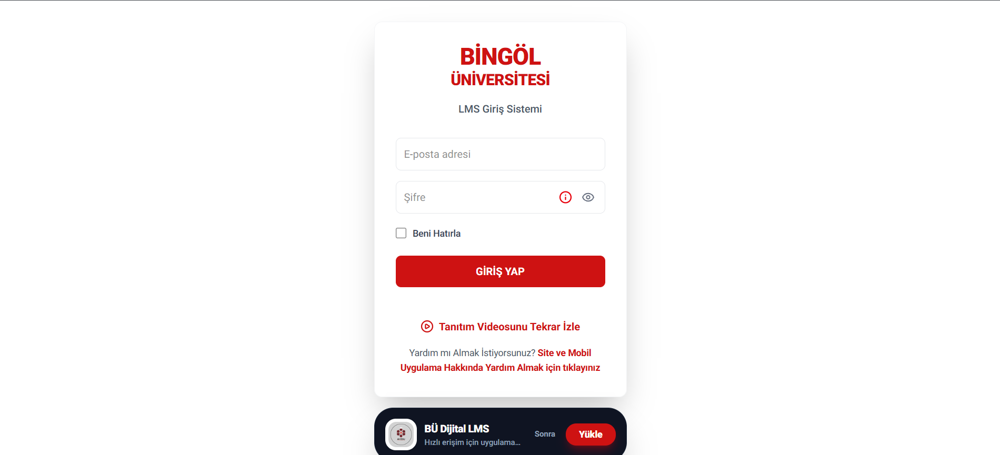
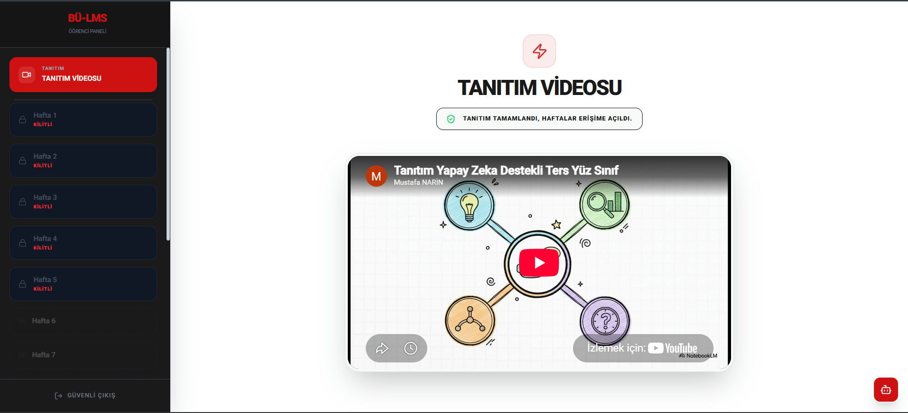

<p align="center">
  
</p>

<h1 align="center">BÜ Dijital LMS</h1>

<p align="center">
  <strong>Yapay Zeka Destekli Dijital Sınıf</strong><br />
  Bingöl Üniversitesi Bilişim Teknolojileri bölümü için geliştirilmiş öğrenme yönetim sistemi
</p>

<p align="center">
  <a href="https://www.yapayzekadesteklidijitalsinif.com.tr/">
    
  </a>
</p>

<p align="center">
  
  
  
  
  
</p>

---

## Proje Hakkında

BÜ Dijital LMS; öğrencilerin haftalık ders içeriklerine erişebildiği, ilerlemelerini takip edebildiği ve yapay zeka asistanıyla etkileşime geçebildiği bir öğrenci paneli ile akademisyenlerin içerikleri ve öğrenci analizlerini yönetebildiği bir yönetim paneli sunar.

Proje aynı zamanda **PWA (Progressive Web App)** olarak kurulabilir; mobil cihazlarda uygulama gibi çalışır ve çevrimdışı önbellekleme desteği sunar.

> **Canlı Uygulama:** [https://www.yapayzekadesteklidijitalsinif.com.tr/](https://www.yapayzekadesteklidijitalsinif.com.tr/)

---

## Ekran Görüntüleri

<table>
  <tr>
    <td align="center" width="50%">
      
      <br />
      <sub><b>Giriş Ekranı</b> — Kurumsal kimlik, PWA kurulum çağrısı ve destek bağlantıları</sub>
    </td>
    <td align="center" width="50%">
      
      <br />
      <sub><b>Öğrenci Paneli</b> — Haftalık içerikler, kilit sistemi ve tanıtım videosu</sub>
    </td>
  </tr>
</table>

---

## İçindekiler

- [Proje Hakkında](#proje-hakkında)
- [Ekran Görüntüleri](#ekran-görüntüleri)
- [Özellikler](#özellikler)
- [Teknoloji Yığını](#teknoloji-yığını)
- [Kurulum](#kurulum)
- [Sayfalar ve Rotalar](#sayfalar-ve-rotalar)
- [Proje Yapısı](#proje-yapısı)
- [API Entegrasyonu](#api-entegrasyonu)
- [PWA ve SEO](#pwa-ve-seo)
- [Güvenlik Notları](#güvenlik-notları)

---

## Özellikler

### Öğrenci Paneli

- **Tanıtım / oryantasyon videosu** ile sisteme giriş
- **Haftalık içerik akışı**: PDF, video, podcast, form (test) ve ödev materyalleri
- İçerik türüne göre sıralı ilerleme ve **tamamlanma takibi**
- **Haftalık değerlendirme testleri** ve anlık puan/sonuç ekranı
- **Yapay zeka destekli sınav analizi**: doğru/yanlış, tahmini puan ve gerçek puan karşılaştırması
- **AI sohbet asistanı** ile haftalık içerik hakkında soru-cevap
- **Ön değerlendirme testi (pre-test)**: yanlış cevaplanan konulara göre ilgili haftaların telafi (remediation) kilidinin açılması
- **Flashcard** (bilgi kartı) desteği
- Toplam puan, izleme süresi ve ilerleme göstergeleri
- Haftalık içerik kilidi, tarih bazlı yayınlama/devre dışı bırakma ve geçici kilit açma desteği
- Hareketsizlik durumunda oturum zaman aşımı uyarısı

### Akademisyen Paneli

- **İçerik yönetimi**: haftalık başlık, açıklama, yayın/devre dışı bırakma tarihleri
- Materyal ekleme (video, PDF, podcast, ödev, test) ve puan/süre tanımlama
- Test soruları ve seçenekleri oluşturma, doğru cevap işaretleme
- Flashcard ve haftalık özet notu ekleme
- Bölüm bazlı yayın planlaması
- **Öğrenci analizleri**: öğrenci bazında ilerleme, puan, süre ve haftalık kırılım
- **Sistem zaman analitiği**
- **Chatbot analitiği**: en çok sorulan sorular ve öğrenci bazlı kullanım
- **Ön değerlendirme / telafi analitiği**
- Öğrenci karnesi ve **toplu akademik rapor** (PDF) çıktısı
- Bölüm bazlı filtreleme ve sayfalama

### Genel

- E-posta + şifre ile giriş; JWT tabanlı kimlik doğrulama
- `is_teacher` bilgisine göre otomatik panel yönlendirmesi
- `@bingol.edu.tr` uzantılı e-posta ile kayıt ve **OTP doğrulama**
- **Şifre sıfırlama** (e-posta ile OTP)
- Kullanım rehberi ve mobil uygulama indirme sayfası
- Duyarlı (responsive) arayüz, mobil öncelikli tasarım
- Service Worker ile PWA kurulumu ve çevrimdışı önbellekleme desteği
- SEO meta etiketleri, `robots.txt` ve `sitemap.xml`

---

## Teknoloji Yığını

| Katman | Teknoloji |
| --- | --- |
| Framework | [Next.js 16](https://nextjs.org/) (App Router) |
| UI Kütüphanesi | [React 19](https://react.dev/) |
| Dil | TypeScript |
| Stil | [Tailwind CSS 4](https://tailwindcss.com/) |
| HTTP İstemcisi | [Axios](https://axios-http.com/) |
| Kimlik Doğrulama | JWT (`jwt-decode`) |
| İkonlar | [Lucide React](https://lucide.dev/) |
| PDF Üretimi | [jsPDF](https://github.com/parallax/jsPDF) + `jspdf-autotable` |
| Kod Kalitesi | ESLint (`eslint-config-next`) |

---

## Kurulum

### Gereksinimler

- **Node.js 20+** (önerilir: güncel LTS)
- **npm** (veya `pnpm` / `yarn` / `bun`)
- Çalışan bir **LMS backend API**'si (varsayılan olarak `http://127.0.0.1:8000/api`)

### Adımlar

```bash
# 1. Depoyu klonlayın
git clone <repo-url>
cd lms_dijital_frontend

# 2. Bağımlılıkları yükleyin
npm install

# 3. Geliştirme sunucusunu başlatın
npm run dev
```

Uygulama [http://localhost:3000](http://localhost:3000) adresinde açılır. Kök adres (`/`) otomatik olarak `/login` sayfasına yönlendirilir.

> **Not:** Backend adresi varsayılan olarak `localhost` için `http://127.0.0.1:8000/api`, canlı ortam için `https://api.yapayzekadesteklidijitalsinif.com.tr/api` olarak belirlenir. Gerekirse `NEXT_PUBLIC_API_URL` ortam değişkeni ile özelleştirilebilir.

---

## Sayfalar ve Rotalar

| Rota | Erişim | Açıklama |
| --- | --- | --- |
| `/` | Herkese açık | `/login` sayfasına yönlendirir. |
| `/login` | Herkese açık | Kullanıcı girişi; rolüne göre panele yönlendirir. |
| `/register` | Herkese açık | Bölüm seçimi, e-posta OTP doğrulaması ve kayıt. |
| `/forgot-password` | Herkese açık | OTP ile şifre sıfırlama. |
| `/guide` | Herkese açık | Video rehberler ve Android (APK) indirme sayfası. |
| `/dashboard` | Öğrenci | Haftalık içerikler, testler, AI sohbet ve analizler. |
| `/teacher-dashboard` | Akademisyen | İçerik yönetimi ve öğrenci/analitik panelleri. |

> Rotalar istemci tarafında token ve JWT içindeki `is_teacher` bilgisine göre yönlendirilir. Üretim ortamında sunucu tarafı yetkilendirme ve rota koruması ayrıca backend tarafında sağlanmalıdır.

---

## Proje Yapısı

```text
.
├── app/                         # Next.js App Router sayfaları
│   ├── layout.tsx               # Kök layout, font, SEO meta ve PWA kaydı
│   ├── page.tsx                 # /login'e yönlendirme
│   ├── login/                   # Giriş sayfası
│   ├── register/                # Kayıt + OTP doğrulama
│   ├── forgot-password/         # Şifre sıfırlama
│   ├── guide/                   # Kullanım rehberi
│   ├── dashboard/               # Öğrenci paneli
│   └── teacher-dashboard/       # Akademisyen paneli
├── components/
│   ├── common/                  # Ortak bileşenler (PWA, oturum zaman aşımı, video modal)
│   ├── student/                 # Öğrenci paneline ait bileşenler
│   ├── teacher/                 # Akademisyen paneline ait bileşenler
│   └── types.ts                 # Paylaşılan TypeScript tipleri ve yardımcılar
├── docs/
│   └── screenshots/             # README ekran görüntüleri
├── lib/
│   └── api.ts                   # Axios örneği, base URL ve interceptor'lar
├── public/                      # Statik dosyalar (ikonlar, manifest, sw.js, robots.txt)
├── next.config.ts               # Statik export ve görsel ayarları
├── tsconfig.json                # TypeScript yapılandırması (@/* alias)
└── package.json
```

---

## API Entegrasyonu

Tüm istekler `lib/api.ts` içindeki Axios örneği üzerinden yapılır:

- **Base URL** öncelik sırası: `NEXT_PUBLIC_API_URL` → tarayıcı hostname'ine göre yerel/canlı adres → varsayılan yerel adres.
- **İstek interceptor'ı**, `localStorage` veya `sessionStorage` içindeki `access_token` değerini `Authorization: Bearer <token>` başlığı olarak ekler.
- **Yanıt interceptor'ı**, `401 Unauthorized` durumlarını yakalar ve oturum süresi uyarısı verir.

Kullanılan başlıca uç noktalar:

| Alan | Uç Nokta |
| --- | --- |
| Kimlik doğrulama | `POST /users/login/`, `POST /users/register/`, `POST /users/send-otp/` |
| Şifre sıfırlama | `POST /users/password-reset-send-otp/`, `POST /users/password-reset-confirm/` |
| İçerikler | `GET/POST /contents/list/` |
| Bölümler | `GET /contents/departments/` |
| İlerleme | `GET /contents/studentprogress/`, `GET /contents/completed-materials-ids/` |
| Materyal tamamlama | `POST /contents/complete-material/` |
| Etkinlik takibi | `POST /contents/track-activity/` |
| Testler | `POST /contents/quiz/{id}/submit/`, `GET /contents/quiz/{id}/last-attempt/`, `GET /contents/quiz-analysis/{attemptId}/` |
| Ön değerlendirme | `POST /contents/pre-test/{id}/submit/`, `GET /contents/pre-test-analytics/` |
| AI sohbet | `POST /contents/ai-chat/` |
| Analitik | `GET /contents/analytics/`, `GET /contents/chatbot-analytics/` |
| Raporlama | `GET /contents/bulk-academic-report/` |

> Uç noktalar backend sözleşmesine bağlıdır; API'de yapılan değişikliklerde ilgili bileşenler ve `lib/api.ts` güncellenmelidir.

---

## PWA ve SEO

- `public/manifest.json` üzerinden uygulama adı, tema rengi (`#ce1212`), ikonlar ve `standalone` görünüm tanımlıdır.
- `public/sw.js` service worker'ı `ServiceWorkerRegister` bileşeni ile kaydedilir; GET istekleri ağ üzerinden yapılır, hata durumunda önbellekten yanıtlanır.
- `PwaInstallBanner` bileşeni destekleyen tarayıcılarda kurulum çağrısı gösterir.
- `app/layout.tsx` içinde başlık şablonu, açıklama, anahtar kelimeler ve `lang="tr"` tanımlıdır.
- `public/robots.txt` ve `public/sitemap.xml` arama motorları için hazırdır.

---

## Güvenlik Notları

- Erişim ve yenileme token'ları `localStorage` ve `sessionStorage` içinde tutulur. XSS riskine karşı backend'den gelen içeriklerin güvenli şekilde işlendiğinden emin olun; ileride `HttpOnly` cookie tabanlı bir akışa geçiş değerlendirilebilir.
- İstemci tarafı yönlendirmeleri tek başına yetkilendirme sayılmaz. Öğrenci/akademisyen ayrımı ve veri erişimi **backend'de** doğrulanmalıdır.
- Yalnızca `@bingol.edu.tr` uzantılı e-postalar kayıt olabilir; bu kontrol hem istemci hem de sunucu tarafında uygulanmalıdır.

---

<p align="center">
  <sub>Bingöl Üniversitesi · Bilişim Teknolojileri · BÜ Dijital LMS</sub>
</p>
